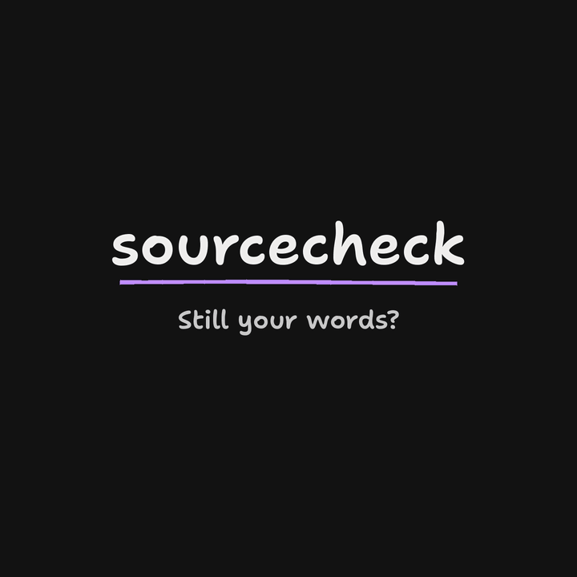
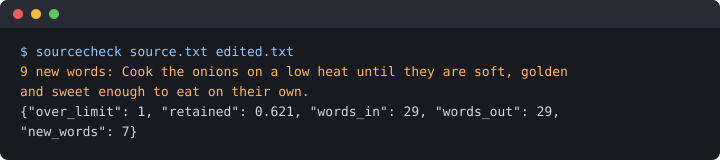

# sourcecheck

sourcecheck compares an edited text with the source it was written from and flags every sentence that adds more than a few words the source never used.

## When to use it

You wrote something and want a model to tighten it without rewriting it. Models drift: they swap your words for theirs a sentence at a time, and the result stops sounding like you. Run sourcecheck on your draft and the model's edit. It flags each sentence that brought in more than a few new words, so you can keep the edit where it stayed on your words and redo it where it did not.

## Install

Python 3.10 or newer, no dependencies.

    pip install git+https://github.com/jburcsik/sourcecheck

Or clone the repository and run `pip install .`, or skip the install and run the single file with `python sourcecheck.py`.

### Single binary

The `rust/` folder holds a Rust port that ships as one file with nothing else to install. Download the archive for your system from the [latest release](https://github.com/jburcsik/sourcecheck/releases/latest), unpack it and put `sourcecheck` on your PATH, or build it with `cargo install --path rust`. On macOS, a binary downloaded in a browser is quarantined until you run `xattr -d com.apple.quarantine sourcecheck`.

On Linux and macOS both versions print the same bytes and exit with the same codes for the same files and options. CI runs them side by side (`rust/parity.py`) on 3,000 generated texts, including sentences of 200+ words, curly quotes, non-breaking and other Unicode spaces, Windows line endings and non-ASCII text, and on a table of command lines covering option prefixes such as `--max 5`, unknown options and odd file names. The known differences: `-h` output does not wrap to the terminal width, `--max-new` accepts ASCII digits only, error messages on stderr are worded differently, and Windows line endings in the output differ because Python writes `\r\n` there.

On a 5,500-word source and edit the binary takes 0.06 s against 1.09 s for the Python version, measured with hyperfine on an Apple M4 Pro laptop.

## Run

    sourcecheck SOURCE EDITED [--max-new N] [--json]

- `SOURCE` is the original text. `EDITED` is the version to check, whether a person or a model made the edit.
- `--max-new` sets how many new words a sentence may add before it is flagged (default 3).
- `--json` prints one JSON object with the summary and a `flagged` list of `{"added": n, "sentence": text}` items.
- Exit code is 0 when nothing is flagged, 1 when something is, 2 on a usage or file error.

## Example

source.txt:

    Peel two onions and slice them thin. Warm a spoon of butter in a wide pan. Cook the onions on a low heat until they turn soft and golden.

edited.txt:

    Warm a spoon of butter in a wide pan. Cook the onions on a low heat until they are soft, golden and sweet enough to eat on their own.

Run the check:

    $ sourcecheck source.txt edited.txt
    9 new words: Cook the onions on a low heat until they are soft, golden and sweet enough to eat on their own.
    {"over_limit": 1, "retained": 0.621, "words_in": 29, "words_out": 29, "new_words": 7}

The second sentence is flagged: against its closest source sentence it inserts or replaces nine words. The first sentence is a straight copy and passes. The summary line reports:

- `over_limit`: sentences flagged.
- `retained`: share of edited words that sit inside a three-word run copied from the source.
- `words_in`, `words_out`: word counts of the source and the edited text.
- `new_words`: distinct edited words that appear nowhere in the source.

## How it works

- A word is a run of letters and numbers with an optional apostrophe part, compared without regard to case.
- A sentence ends at `.`, `!` or `?` followed by whitespace. The source is read as one text. Each line of the edited file is split on its own, so keep each edited paragraph on one line.
- Each edited sentence is matched with the source sentence that needs the fewest added words, using `difflib.SequenceMatcher` on the word lists (ported line for line in `rust/src/difflib.rs`). Inserted and replaced words count as added; deleted words do not.

## What it does not do

- It matches English-style words only. Writing systems that do not put spaces between words will not split correctly.
- It splits sentences on punctuation alone, so abbreviations and decimals can split a sentence early.
- It does not judge meaning. A sentence can keep every word and still say something different, or use new words to say the same thing.

## Tests

    pip install ".[dev]"
    pytest

For the Rust port:

    cd rust
    cargo test
    cargo build --release
    python3 parity.py

## Security

To report a security problem, use the repository's private vulnerability reporting on GitHub rather than a public issue.

## License

MIT
